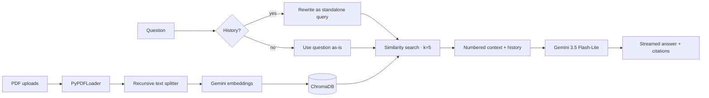

# GetMeContext

**Ask questions across your PDFs — get answers grounded in the source, with page-level citations.**

[](https://github.com/Dashetty/GetMeContext/actions/workflows/ci.yml)
[](https://www.python.org/)
[](https://streamlit.io/)
[](LICENSE)

> **Live demo:** _add your Streamlit Cloud URL here after deploying (see [Deploy](#deploy-free-on-streamlit-community-cloud))._

<!-- Replace the line above with: **Live demo:** [getmecontext.streamlit.app](https://your-app.streamlit.app) -->

---

## Why this exists

Most "chat with your PDF" demos hallucinate. GetMeContext is a small, opinionated
RAG application that refuses to answer when the document does not contain the
answer. Every answer is traceable to the file and page it came from.

Built as an interview-ready reference implementation: typed configuration,
separation of concerns, a real test suite, and a one-click path to a free public
deployment.

## Features

- **Multi-document Q&A** — upload one or many PDFs and query them together.
- **Grounded answers only** — the prompt forbids outside knowledge and returns
  *"The answer is not available in the uploaded document."* when context is missing.
- **Page-level citations** — the model cites numbered sources (`[1]`, `[2]`) and the
  UI expands into the exact file, page, and chunk snippet.
- **Conversational memory** — follow-up questions ("when is *it* due?") are rewritten
  into standalone search queries before retrieval.
- **Streaming responses** — tokens render as Gemini generates them.
- **Transparent failures** — ingestion and API errors are surfaced with actionable
  messages instead of silent empty answers.
- **Downloadable transcript** — export the conversation and its sources as Markdown.
- **Local-first storage** — the vector index lives in ChromaDB on disk; document
  text is sent to Google only for embedding and for answering questions.

## Architecture



**Ingestion:** each PDF is parsed page by page, split into 1,000-character chunks
with 200-character overlap, embedded with `gemini-embedding-001`, and written to a
persistent Chroma collection.

**Retrieval:** follow-up questions are condensed using recent chat history, then the
top-5 most similar chunks are retrieved.

**Generation:** chunks are numbered and injected into a strict prompt. Gemini streams
an answer that cites those numbers, and the UI pairs the answer with the same
numbered sources.

## Tech stack

| Layer | Choice | Why |
|-------|--------|-----|
| UI | Streamlit | Fast to ship, native file upload, chat primitives, free hosting |
| Orchestration | LangChain (LCEL-friendly) | Composable retrieval/generation pieces |
| Embeddings | Gemini `gemini-embedding-001` | No extra vendor, strong multilingual retrieval |
| LLM | Gemini `gemini-3.5-flash-lite` | Free-tier friendly, ~500 req/day, configurable |
| Vector store | ChromaDB | Local persistence, zero infrastructure |
| PDF parsing | pypdf | Page-level text extraction and metadata |
| Quality | pytest + ruff + GitHub Actions | Regression safety and consistent style |

## Quick start

```bash
git clone https://github.com/Dashetty/GetMeContext.git
cd GetMeContext

python -m venv .venv
source .venv/bin/activate        # Windows: .venv\Scripts\activate
pip install -r requirements.txt

cp .env.example .env
# Add GOOGLE_API_KEY (free at https://aistudio.google.com/app/apikey)

streamlit run app.py
```

Open <http://localhost:8501>, upload a PDF, and ask a question.

> On NTFS or network mounts where console scripts lose their executable bit, run
> `python -m streamlit run app.py` instead.

## Configuration

Every setting can be provided through `.env` locally or **Streamlit secrets** when
deployed. Environment variables take priority; defaults are sensible.

| Variable | Default | Purpose |
|----------|---------|---------|
| `GOOGLE_API_KEY` | — | **Required.** Gemini API key |
| `GOOGLE_LLM_MODEL` | `gemini-3.5-flash-lite` | Chat model for answers |
| `GOOGLE_EMBEDDING_MODEL` | `models/gemini-embedding-001` | Embedding model |
| `CHUNK_SIZE` | `1000` | Characters per chunk |
| `CHUNK_OVERLAP` | `200` | Overlap between chunks |
| `TOP_K` | `5` | Retrieved chunks per question |
| `CONVERSATION_WINDOW` | `3` | Previous turns used as memory |
| `CHROMA_PERSIST_DIR` | `chroma_db` | Local vector store directory |
| `CHROMA_COLLECTION` | `docquery_docs` | Chroma collection name |
| `MAX_UPLOAD_MB` | `50` | Per-file upload limit |

### Choosing a free model

`gemini-2.5-flash` is deprecated. From **1 December 2026**, requests to it are
routed to `gemini-3.5-flash-lite`, and new projects cannot select it. Current
free-tier options:

| Model | Free tier | Typical free quota* | Trade-off |
|-------|-----------|---------------------|-----------|
| `gemini-3.5-flash-lite` (default) | ✅ | ~500 req/day, 15 RPM | Google's official 2.5 Flash replacement; best quota |
| `gemini-3.1-flash-lite` | ✅ | ~500 req/day | Older Lite model |
| `gemini-3.8-flash` | ✅ | ~20 req/day, 5 RPM | Better answers, tiny free quota |
| `gemini-4-hydrogen` | ✅ | Varies (Flash-class) | Newest free model, strongest answers |

\*Google does not publish fixed free-tier limits. Check **AI Studio → Rate
limits** for your own project; limits are per project (not per key) and reset at
midnight Pacific. Set `GOOGLE_LLM_MODEL` to switch.

Two free-tier caveats:

- Google may use free-tier prompts and document text to improve its products.
  **Do not upload confidential documents.**
- A public demo can exhaust a daily quota. The app turns `429` responses into a
  clear "quota exhausted" message rather than an opaque failure.

The embedding model intentionally stays `gemini-embedding-001`: it is text-only,
supports the `task_type` routing this pipeline uses, and avoids the re-embedding
incompatibility of `gemini-embedding-2`.

## Deploy (free) on Streamlit Community Cloud

This repo is already deployment-ready: settings are read from `st.secrets` when
environment variables are absent.

1. **Push the repo to GitHub** (public — Community Cloud requires it).
2. Go to <https://share.streamlit.io> → **Create app** → *Deploy a public app from GitHub*.
3. Select the repository, branch `master`, and main file `app.py`.
4. Open **Advanced settings** → choose **Python 3.12**.
5. Under **Secrets**, paste:

   ```toml
   GOOGLE_API_KEY = "your_google_api_key_here"

   # Optional overrides
   GOOGLE_LLM_MODEL = "gemini-3.5-flash-lite"
   GOOGLE_EMBEDDING_MODEL = "models/gemini-embedding-001"
   ```

6. Click **Deploy**, then replace the live-demo link at the top of this README.

**Things to know about the free tier**

- Apps sleep after inactivity; the first visit afterwards takes a moment to wake.
- The filesystem is ephemeral: the Chroma index is rebuilt when a new PDF set is
  uploaded or the app restarts. There is no user data to lose.
- Free Gemini quotas vary by model and project. The Flash-Lite default
  (~500 requests/day) is sized for a public demo; the UI reports quota and API
  errors explicitly.
- Free-tier prompts and document text may be used to improve Google's products —
  keep confidential PDFs out of the demo.

## Testing & quality

```bash
pip install -r requirements-dev.txt
pytest            # unit tests: config, loaders, chunking, retrieval, citations, helpers
ruff check .      # lint
```

The suite runs without network access or an API key: embeddings and LLM calls are
stubbed, while ChromaDB is exercised against a temporary directory. GitHub Actions
runs both checks on every push.

> On NTFS or network mounts where console scripts lose their executable bit, run
> `python -m pytest` and `uvx ruff check .` instead.

## Project structure

```
GetMeContext/
├── app.py                     # Streamlit UI: upload, index, stream, citations
├── utils/
│   ├── config.py              # Typed settings: env → secrets → defaults
│   ├── pdf_loader.py          # Page-level extraction + metadata normalisation
│   ├── vector_store.py        # Chunking, embedding, ChromaDB lifecycle
│   ├── rag_chain.py           # Condense → retrieve → prompt → stream
│   └── helpers.py             # Upload signatures, transcripts, summaries
├── tests/                     # pytest suite (no API calls)
├── .github/workflows/ci.yml   # Lint + test on every push
├── .streamlit/config.toml     # Theme and upload limit
├── .env.example               # Configuration template
└── requirements.txt
```

## Design decisions

- **One collection, rebuilt on upload.** Simpler than per-file collections and it
  guarantees retrieval never mixes chunks from a previous document set. The cost
  (re-embedding) is acceptable for resume-scale demos.
- **Quota-aware model choice.** The default is the highest-quota free model
  (`gemini-3.5-flash-lite`), not the newest one, because a public demo exhausts a
  Flash model's ~20 requests/day almost immediately. Quality upgrades are one
  environment variable away.
- **Asymmetric embeddings.** Document chunks use Gemini's `retrieval_document`
  task type and queries use `retrieval_query`, which improves matching without a
  second model or index.
- **Citations are structural, not cosmetic.** Context blocks are numbered before the
  LLM sees them, so citation markers map deterministically to UI sources.
- **Condense only when needed.** History-aware query rewriting costs an extra LLM
  call, so it is skipped for the first question and when history is empty.
- **Strict groundedness.** The system prompt forbids outside knowledge and prescribes
  an exact refusal string; retrieval failures surface as an honest "not available".
- **Configuration is a typed object**, resolved once per session, shared by the app
  and tests. No magic constants scattered across modules.
- **Failures are first-class.** Corrupt or scanned PDFs, oversized uploads, missing
  keys, and API quota errors all produce distinct, actionable messages.

## Limitations & roadmap

- Scanned PDFs need OCR before upload (not bundled, to keep the image small).
- Retrieval is similarity-only; a reranking or MMR step would help long documents.
- Add a RAG evaluation harness (RAGAS or a golden Q&A set) to measure groundedness.
- Optional: per-document filtering, authentication, and request rate limiting before
  promoting a public demo.

## License

MIT — see [LICENSE](LICENSE).
